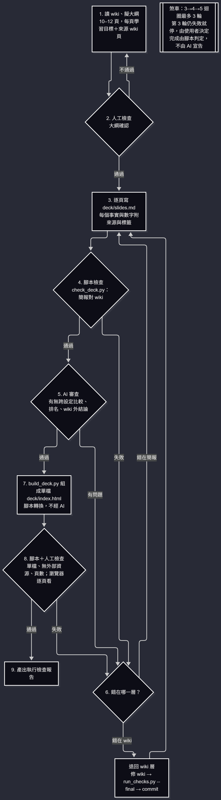

# 第 10 週作業：語音情緒辨識（SER）LLM Wiki 與教學簡報

- **簡報（GitHub Pages）**：https://jacky1-collab.github.io/ser-llm-wiki/deck/
- **Wiki**：https://github.com/jacky1-collab/ser-llm-wiki/tree/master/wiki （從 [wiki/index.md](wiki/index.md) 開始讀）
- **Repository**：https://github.com/jacky1-collab/ser-llm-wiki
- **規則檔**：[AGENTS.md](AGENTS.md)
- **流程圖**：[deck/workflow-graph.png](deck/workflow-graph.png)（Mermaid 原始檔 [deck/workflow-graph.mmd](deck/workflow-graph.mmd)）
- **執行檢查紀錄**：[deck/check-log.md](deck/check-log.md)

---

## 1. 這份 wiki 在做什麼

主題是語音情緒辨識（Speech Emotion Recognition, SER），重點放在兒童。我讀了 5 篇論文，讓 AI 照我定的規則整理成一個 LLM Wiki，再只用 wiki 的內容做一份給新手看的教學簡報。

| 論文頁 | 類型 | 為什麼選 |
|---|---|---|
| [2008-fau-aibo](wiki/papers/2008-fau-aibo.md) | 資料集 | 兒童自發情緒語音的代表資料庫 |
| [2016-emoreact](wiki/papers/2016-emoreact.md) | 資料集＋基準 | 兒童視聽情緒資料集 |
| [2021-pepino-wav2vec2-ser](wiki/papers/2021-pepino-wav2vec2-ser.md) | 方法 | 用自監督語音模型做 SER |
| [2024-ser-evals](wiki/papers/2024-ser-evals.md) | 基準評測 | 域內／域外泛化的評測 |
| [2026-review-ser-adults-children](wiki/papers/2026-review-ser-adults-children.md) | 綜述 | 成人與兒童 SER 的整體比較 |

Wiki 的內容：

- **論文頁 5 頁**，依論文類型決定哪些章節必填。
- **實體頁 20 頁**：主題 3、資料集 11、特徵 4、模型 1、評測 1。只有被 2 篇以上提到、或是某篇的核心貢獻，才會建頁。
- **綜合頁 5 頁**：資料集對照、評測矩陣、成人與兒童、特徵與模型做法、開放問題。
- **[index.md](wiki/index.md)** 是總目錄，**[log.md](wiki/log.md)** 記錄每次 ingest 與修改，只能往下新增。

PDF 有版權，只放在我電腦的 `raw/`，用 `.gitignore` 排除，沒有上傳。

## 2. 需求摘要（先討論、後產生）

動手前先讓 AI 訪問我 10 題，我逐題決定。重點如下：

- **來源**：知識只能來自 `raw/` 的 5 篇 PDF，AI 不能補自己的背景知識。論文沒寫的寫「論文未提及」，結構上沒有的寫「不適用（附理由）」。
- **語言**：繁體中文為主，專有名詞第一次出現寫「中文（英文）」，數字、資料集與模型名稱保留原文，引文保留英文原句。
- **數字**：每個數字後面都要標 `[本文]`（這篇自己的結果）或 `[引述]`（轉述別篇），再加 PDF 頁碼。頁碼只能用 `(p. N)`、`(p. N, Table M)`、`(p. N, Fig. M)`、`(pp. N–M)` 四種寫法。
- **作者說的和 AI 整理的分開**：核心貢獻的每一條都要標 `[作者聲稱]` 或 `[AI 整理，待核對]`。
- **矛盾**：每頁都有「矛盾／待釐清」。AI 不能自己選邊，要並列雙方說法和頁碼。設定不同時要寫「設定不同，不可直接比較」，並說明差在哪裡。
- **順序**：一次只處理一篇，綜述放最後，用來檢查綜述的二手轉述。前 2 篇要等我確認才寫檔，後 3 篇改成看 `git diff` 和腳本報告。
- **讀者**：wiki 的讀者是我自己和做簡報的 AI；簡報的讀者是不熟這個主題的新手。
- **簡報**：單檔 HTML，10–12 頁，只能讀 wiki，不能讀 PDF。

完整規則在 [AGENTS.md](AGENTS.md)（10563 字元，上限 12000）。

## 3. 簡報的 loop／graph 設計

| 節點 | 誰檢查 | 做什麼 |
|---|---|---|
| 1 擬大綱 | AI | 讀 wiki，列 10–12 頁，每頁寫學習目標和來源 wiki 頁 |
| 2 確認大綱 | 人 | 不通過就回到 1 |
| 3 寫 slides.md | AI | 每個數字照 wiki 論文頁的「數字＋標籤＋頁碼」寫，並附來源 |
| 4 check_deck.py | 腳本 | 簡報對 wiki：數字、引文、來源 slug、頁數、標題不得含數字 |
| 5 AI 審查 | AI | 腳本抓不到的：跨設定比較沒加註、排名暗示、wiki 以外的說法 |
| 6 錯在哪一層 | 人＋AI | 錯在簡報就回到 3；錯在 wiki 就**退回 wiki 層**，修好、跑 `run_checks.py --final`、commit 之後再回到 3 |
| 7 build_deck.py | 腳本 | 把 slides.md 轉成單檔 HTML，**不經過 AI** |
| 8 HTML 檢查 | 腳本＋人 | `check_deck.py --html`：沒有外部資源、頁數相同，而且必須和 build_deck.py 重新產生的結果逐位元組相同；人再用瀏覽器逐頁看 |
| 9 檢查報告 | AI | 寫進 deck/check-log.md |

**煞車**：3→4→5 最多跑 3 輪，第 3 輪還失敗就停下來，由我決定。「完成」由腳本判定，不由 AI 宣告。

設計重點有兩個：

- **第 6 步分兩條路。** 簡報的錯有可能是 wiki 本身少了東西。這時如果只在簡報上補，簡報就會出現 wiki 沒有的內容，「簡報只讀 wiki」這條規則就破了。
- **第 7 步交給腳本。** 原本第 7 步是 AI 組 HTML。我測試時發現，AI 在這一步可以加入沒檢查過的句子，例如「UAR 99.9% 遠勝所有方法」，而檢查照樣會過（錯誤紀錄 #74）。這一步不需要判斷力，所以換成腳本，再要求 HTML 和腳本產生的結果完全一樣。

## 4. 一次實際執行的檢查紀錄

完整紀錄在 [deck/check-log.md](deck/check-log.md)，簡報一共跑了 3 輪：

| 輪 | 走的路線 | 發生什麼 | 誰發現 |
|---|---|---|---|
| 1 | 3→4→5→6→3 | check_deck 通過，但 AI 審查抓到 2 處：第 2 頁有一句 SER 定義是 wiki 沒有的；第 7 頁把兩篇的數字放在一起，只說「發現」不可比，沒說「數字」也不可比 | AI 審查（腳本抓不到） |
| 2 | 3→4→5→7→8 | 腳本全部通過，進入瀏覽器人工檢查 | 腳本 |
| 3 | 8→6→**退回 wiki**→3→4→5→7→8→9 | 我在瀏覽器看到三個問題：新手看不懂 `[本文]` 和〔來源〕；第 8 頁來源重複；第 2、8 頁只能用轉述。原因是需要的英文原句只記在實體頁和綜合頁，論文頁沒有，而 check_deck 只認論文頁的引文。判斷是 wiki 層的缺漏：先把 4 句原文補進論文頁，`run_checks.py --final` 通過並 commit，再回去改簡報。這一輪全部通過 | 人（我） |

第 3 輪是 graph 裡「錯在 wiki」那條分支第一次真的被走到。改完之後，Claude Code 也主動指出 AGENTS.md §7.3 原本只允許改舊頁的三個區塊，所以我在 AGENTS.md 補了一條例外：「因下游需要補記原文引文時，只能新增、不得改寫」。

Wiki 層也有實際攔下錯誤的例子。Ingest 第 2 篇時，`run_checks.py` 第一次執行失敗，原因是 `2021-pepino-wav2vec2-ser.md:190` 寫了「第 1 篇是德國兒童…」，`1` 是一個沒有標籤也沒有頁碼的數字。改成 `[[2008-fau-aibo]]` 之後重跑，267 筆全部通過。

## 5. 檢查工具

| 腳本 | 檢查什麼 | 本身怎麼驗證 |
|---|---|---|
| `check.py` | 10 項：連結、孤兒頁、實體與論文雙向一致、必填章節、PDF 與論文頁一對一、建頁門檻、index、log 格式、摘要不得含數字、AGENTS.md 字數 | 變異測試 |
| `check_numbers.py` | 每個數字都要有標籤和頁碼，再用 pypdf 到 PDF 那一頁找這個數字；引文要逐字出現在那一頁 | 單元測試 41 項、變異測試 88 案 |
| `check_deck.py` | 簡報對 wiki（見第 3 節），`--html` 檢查 HTML | 30 案 |
| `build_deck.py` | slides.md → index.html，固定轉換、不經 AI | 包含在上面 30 案裡 |

「變異測試」是在臨時副本裡故意放錯，例如捏造數字、拿掉標籤、改頁碼、留空章節，確認腳本真的會失敗，而且失敗的原因是對的。腳本前後改了 4 版才放行，第 1–3 版的漏洞大多是我們自己用假資料實跑才發現的，不是 AI 的測試報告發現的。

## 6. 反思

### 哪個節點最常出錯？

我把過程中的錯誤和檢查都編號記錄，一共 81 筆。依階段分：

| 階段 | 筆數 |
|---|---|
| 需求訪談、需求摘要、AGENTS.md | 19 |
| **寫檢查腳本（含測試）** | **33** |
| 5 篇 Ingest | 17 |
| 綜合頁 | 3 |
| 簡報工具與簡報 | 7 |
| AGENTS.md 更新、比較表 | 2 |

**最常出錯的是「寫檢查工具」這個節點本身。** 腳本會漏抓最常見的寫法，例如條列開頭的數字、小數；測試會變成空測試，例如變異函式寫了 `pass`、兩個案例其實是同一個；修一個洞又開另一個洞，例如修引述行之後，引號前面的文字反而不檢查了。這一類錯誤最麻煩，因為腳本和測試會一起顯示「全部通過」。「41/41 通過」只代表有測的 41 件事是對的。

另一種錯誤貫穿每個階段：**AI 的自述和實際情況不一樣**。例如 AI 說「已完整收錄」，但其實缺了 7 處；說測試「成功攔截」，其實是因為沒裝 pypdf，腳本根本沒跑；說名稱清單「依檔案順序遮蔽」，其實是依長度排序；說流程圖檔案「不存在」，其實早就 commit 了。

腳本放行以後，Ingest 階段剩下的錯誤幾乎都是**語意層級**的：引文存在，但撐不起旁邊那句話；原文的「非常粗略的估計」被拿掉了「非常粗略」；「某個量級」被寫成「數個量級」。這些腳本抓不到，只能靠人對照 PDF。

### 檢查往前移到哪裡？

1. **寫腳本之前，先在腦中推演一次 ingest。** 「PDF 與論文頁一對一」這條規則，在逐篇 ingest 的途中一定會失敗；「建頁門檻」會讓論文頁連到還不存在的頁面。這些都是推演時發現的，不是等到實際做了才發現。
2. **寫 wiki 之前，先驗證檢查工具。** 腳本改了 4 版、通過單元測試和變異測試之後，才開始 ingest 第一篇。驗證方式不採信 AI 貼的輸出，而是自己用假資料實跑，再由我自己在 PowerShell 重跑。
3. **數字核對從「事後人工看表」移到「寫完立刻由腳本比對 PDF」。** 第 9 週是在回報附一張人工核對表；第 10 週是 check_numbers.py 每次都直接到 PDF 那一頁找數字。
4. **寫簡報之前，先寫好 check_deck.py。** 而且把第 7 步從 AI 換成腳本，等於把「HTML 有沒有被加料」這個檢查，移到根本不讓它發生。
5. **把「放寬規則」的權限拿走。** 名稱例外清單和數字豁免清單只有我能改，AI 只能回報，避免 AI 為了讓檢查通過而自己放寬例外。

### 因此改了什麼 workflow？

- **規則的完成由腳本判定**，AI 回報「完成」不算數。每次都要看 `git diff`、腳本輸出，必要時我自己重跑。
- **加了 build_deck.py，第 7 步不經 AI**，`--html` 要求逐位元組一致。
- **graph 加了「錯在 wiki → 退回 wiki 層」的分支**，第 3 輪真的走到之後，再把 AGENTS.md §7.3 補上「只能新增引文」的例外。
- **前 2 篇互動確認，後 3 篇改看 diff＋腳本報告**，速度變快，但每篇仍然由人對照 PDF 抽查。
- **規則字面跟著實際情況修正**：例外 6 從「模型／資料集／指標名稱」加上「特徵」（遇到 MFCC 14、F0）；加上「名稱清單不得包含會出現在 slug 的字串」（加入 wav2vec2 會讓所有 `[[2021-pepino-wav2vec2-ser]]` 連結誤報）。

## 7. 第 9 週與第 10 週的 AGENTS.md 比較

第 9 週：[speech-emotion-notes/AGENTS.md](https://github.com/jacky1-collab/speech-emotion-notes/blob/main/AGENTS.md)（7407 字元）；第 10 週：[AGENTS.md](AGENTS.md)（10563 字元）。

| 面向 | 第 9 週（文獻筆記站） | 第 10 週（LLM Wiki＋簡報） | 為什麼改 |
|---|---|---|---|
| 產出 | 靜態網站：一篇論文一頁 HTML，`notes.json` 產生首頁目錄 | Markdown wiki：論文頁、實體頁、綜合頁、index、log，加上下游簡報 | 作業要求跨論文的知識庫；同一個資料集或特徵散在好幾篇，需要實體頁串起來 |
| 筆記格式 | 固定 6 欄，順序不能換 | 依論文類型（方法／資料集／綜述／基準評測）訂必填選填表；分清「論文未提及」「不適用（附理由）」「論文未定義」 | 5 篇類型不同，硬套同一個格式會讓 AI 去填不存在的內容 |
| 數字出處 | 「PDF 第 X 頁」；回報附人工「數字核對表」；網站不放原文 | 四種頁碼格式＋`[本文]`／`[引述]` 標籤；check_numbers.py 自動到 PDF 那頁比對；引文直接寫進 wiki 並逐字比對 | 綜述轉述的別篇數字容易被當成本文結果；人工核對表逐列很花時間，也會漏 |
| 推測 | 標「（AI 推測，待查證）」並加 `class="inferred"` | 核心貢獻每條標 `[作者聲稱]` 或 `[AI 整理，待核對]` | 作用相同，改成 Markdown 標籤 |
| 跨論文 | 筆記彼此獨立，沒有規定 | 建頁門檻、綜合頁、每頁「矛盾／待釐清」、「設定不同，不可直接比較」 | 5 篇的資料集、切分、指標都不同；綜述對資料集的描述也和原始論文不一致 |
| 修改既有內容 | 不刪除、不覆蓋舊筆記；首頁、CSS、JS、模板、腳本未經要求不得修改 | 舊頁只能改三個區塊，加上「補記引文只能新增」的例外，都要記 log update；腳本唯讀 | 實體建頁後要回補連結；簡報需要的原句不在論文頁 |
| 流程 | 每篇「計畫 → 確認 → 執行」，只寫確認過的內容 | 前 2 篇確認，後 3 篇看 diff＋腳本報告；簡報 9 節點 graph，迴圈最多 3 輪 | 篇數變多，需要加快；graph 讓錯誤回到最接近源頭的地方修 |
| 檢查 | check.py 8 項（結構、路徑、PDF 未進 Git），內容由人確認 | check.py 10 項＋check_numbers＋check_deck；腳本本身要通過單元測試和變異測試；完成由腳本判定 | AI 寫的測試曾經是空測試；AI 會自稱完成 |
| 停止條件 | PDF 讀不出、分不清是哪一篇就停 | 再加上規則衝突、頁碼存疑、資料不足；腳本失敗最多自修 3 輪 | 避免 AI 為了通過檢查一直硬改 |
| 使用者專用清單 | 無 | 名稱例外、數字豁免只能由我編輯 | 避免 AI 自己放寬例外 |
| 規則檔限制 | 無 | 12000 字元上限、不建 GEMINI.md | 工具對規則檔有長度和優先順序的限制 |
| 沒變的 | 一句摘要不放數字；PDF 不進 Git；noreply 信箱、明確路徑 add、我說才 commit | 相同；摘要規則改由 check.py 自動檢查；另外每篇 Ingest 各 commit 一次 | 第 9 週有效的做法就延續 |

**一句話總結**：第 9 週的規則主要在管「AI 寫出來的東西長什麼樣子」，內容是否正確靠人看。第 10 週把能機械判斷的部分（數字、頁碼、引文、連結、格式）都交給腳本，人只看腳本做不到的語意。另外多了「錯了要回到哪一層修」的規則。

## 8. 已知限制

- 數字檢查只確認「這個數字出現在標註的那一頁」，不確認它是不是那個句子、那個表格格子裡的數字。同一頁的數字被搬到別的句子，腳本抓不到。
- 只檢查阿拉伯數字，「三類情緒」這種中文數字不檢查。
- wiki 的標題行不檢查數字（簡報的標題有檢查）。
- 引文只比對「有沒有在那一頁」，不比對它是否支持旁邊那句話。
- 多行寫法的 YAML authors 會被誤判成空白（會失敗，不會誤過）。
- log.md「只能新增」不是腳本檢查，是我每次用 `git diff` 看。
- 公開的 repo 沒有 PDF，所以別人 clone 下來跑 `check.py` 時，「PDF 與論文頁對齊」那一項會失敗，`check_numbers.py` 也無法比對；`check_deck.py` 和 `test_check_deck.py` 可以正常跑。
- 在 GitHub 上，`[[slug]]` 不會變成可以點的連結；檔名就是 slug，可以直接在資料夾裡找到。

## 9. 工具與 AI 協助說明

- **執行**：一開始用 Antigravity（Gemini，額度用完後改 Sonnet 4.6）做需求訪談、AGENTS.md 和第 1–2 版腳本。11/20 模型額度用完，要 11/27 才重置，已經晚於截止日，所以之後改用我自己 Claude Pro 方案的 Claude Code，在本機執行。
- **審查**：另外開一個 Claude 對話（claude.ai Project）負責審查：對照 PDF 核對數字與引文、自建測試案例實跑腳本、審查 diff。維護 wiki 的 agent 不審查自己的成果。
- **我做的**：所有決定（主題、論文、規則、要不要修、退回哪一層）、名稱例外清單、瀏覽器檢查，以及所有 git 操作（add、commit、push 都是我自己在 PowerShell 執行）。
- 錯誤與檢查紀錄共 81 筆，是這份反思的依據。
